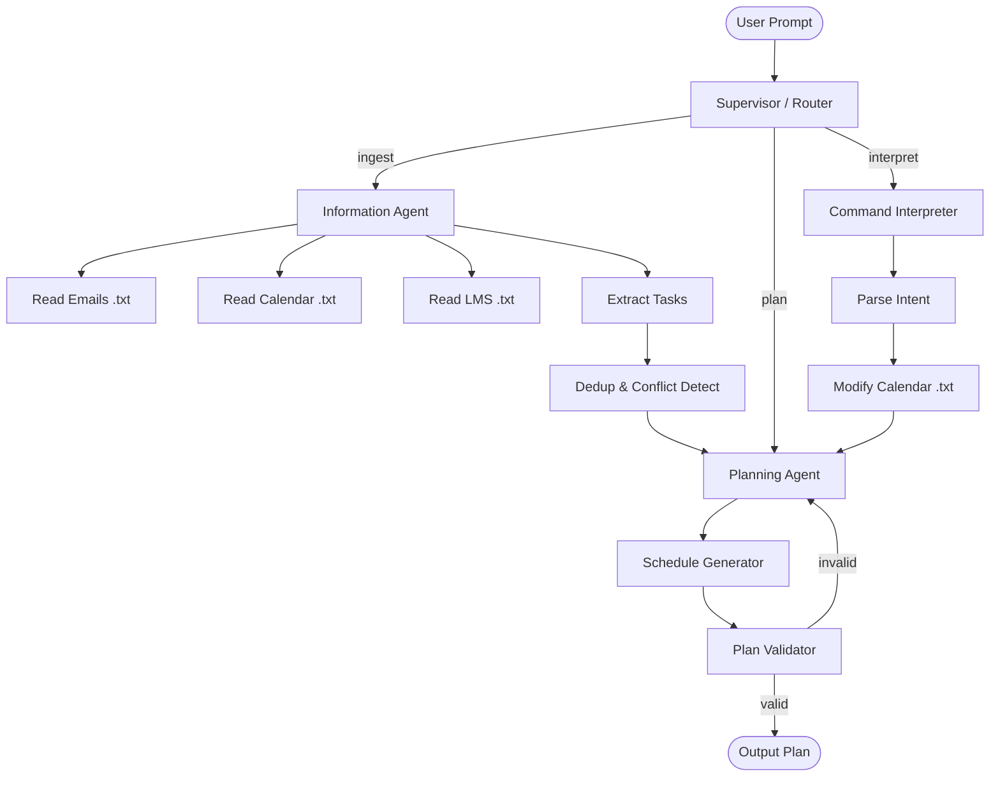

# Phase 0 — LangGraph Skeleton with Dummy Data

## Goal
Validate the full agent graph flow end-to-end using dummy `.txt` files instead of live APIs. No MCP, no RAG, no real LLM calls yet — just the **graph structure**, **state schema**, and **deterministic logic**.

## Architecture (Simplified for Phase 0)



## What Each Node Does (Phase 0)

| Node | Phase 0 Behavior |
|------|-----------------|
| **Supervisor** | Simple keyword router — routes to `ingest`, `plan`, or `command_interpret` based on user input |
| **Information Agent** | Reads dummy `.txt` files (emails, calendar, LMS announcements), returns raw text |
| **Task Extractor** | Parses structured dummy data (simple `key: value` format) into task dicts |
| **Dedup & Conflict Detector** | Deterministic Python — finds tasks with same name but different deadlines across sources |
| **Planning Agent** | Sorts tasks by deadline, assigns to available time slots |
| **Schedule Generator** | Greedy slot-filler using free time from calendar |
| **Plan Validator** | Checks: (a) no overlaps, (b) total hours ≤ available hours, (c) every task traced to a source |
| **Command Interpreter** | Regex/keyword-based intent parser (e.g., "cancel" → delete, "move" → reschedule) |

## Dummy Data Files

- `data/emails.txt` — Academic email announcements with deadline info
- `data/calendar.txt` — Current calendar events (classes, existing commitments)
- `data/lms.txt` — LMS course announcements / assignment listings

## File Structure

```
personal_agent/
├── data/
│   ├── emails.txt
│   ├── calendar.txt
│   └── lms.txt
├── agent/
│   ├── __init__.py
│   ├── state.py          # TypedDict state schema
│   ├── nodes/
│   │   ├── __init__.py
│   │   ├── supervisor.py
│   │   ├── ingest.py
│   │   ├── task_extractor.py
│   │   ├── conflict_detector.py
│   │   ├── planner.py
│   │   ├── validator.py
│   │   └── command_interpreter.py
│   └── graph.py          # LangGraph graph definition
├── main.py               # Entry point
├── requirements.txt
└── Academic Workflow Agent — Requirement Analysis.md
```

## State Schema (Shared across all nodes)

```python
class AgentState(TypedDict):
    user_input: str
    route: str                           # "ingest" | "plan" | "command"
    raw_emails: list[str]
    raw_calendar: list[dict]
    raw_lms: list[str]
    extracted_tasks: list[dict]          # {title, deadline, source, type, effort_hrs}
    conflicts: list[dict]               # {task, source_a, source_b, field, values}
    schedule: list[dict]                 # {task, date, start, end}
    validation_result: dict             # {valid: bool, issues: list[str]}
    plan_output: str
    command_intent: dict | None         # {action, target_event, params}
    messages: list[str]                 # log / trace
```

> [!IMPORTANT]
> This phase uses **no LLM calls** — everything is deterministic Python parsing dummy structured text. This isolates graph-flow bugs from LLM unpredictability.

## Next Phases (After This Works)
1. **Phase 1**: Swap dummy parsers with Groq/Gemini LLM calls for task extraction & supervisor routing
2. **Phase 2**: Add MCP servers for real Calendar/Email
3. **Phase 3**: Add RAG (Chroma) for memory/calibration
4. **Phase 4**: Document upload + parsing
